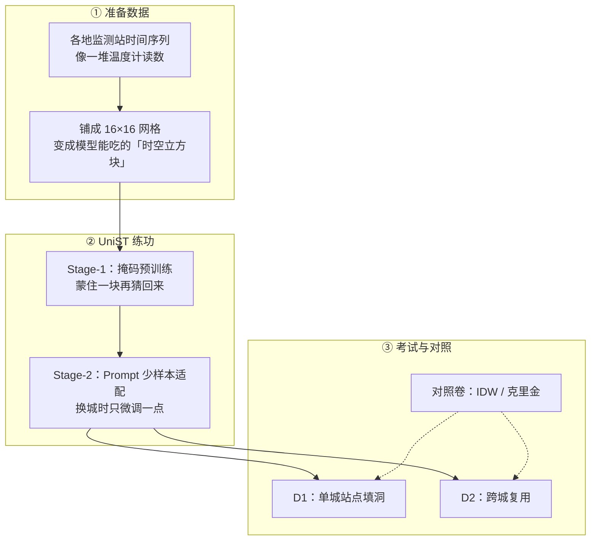
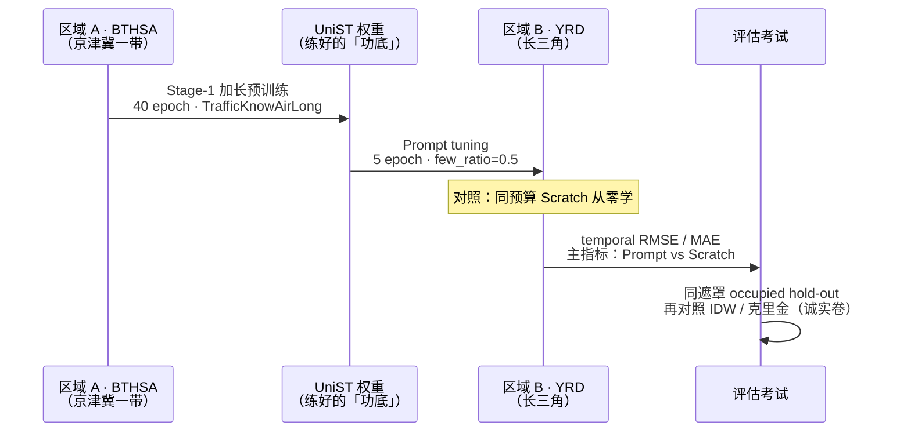
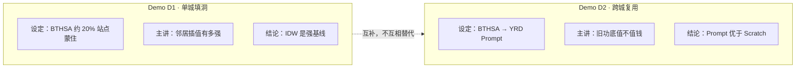
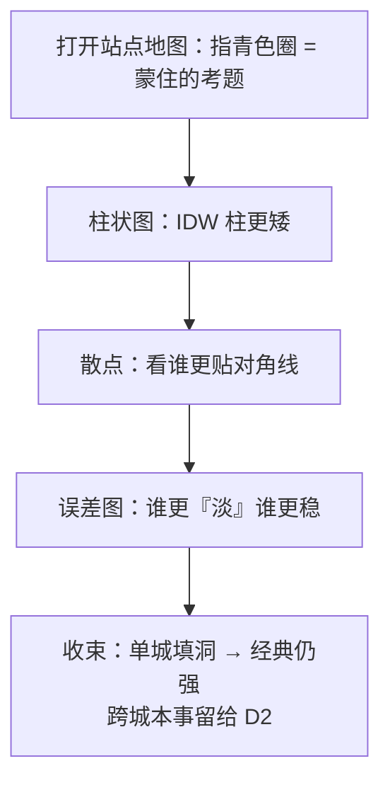
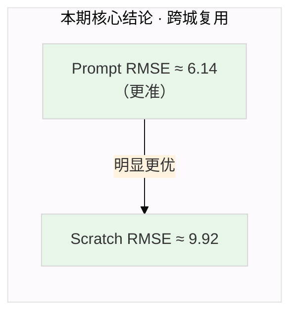
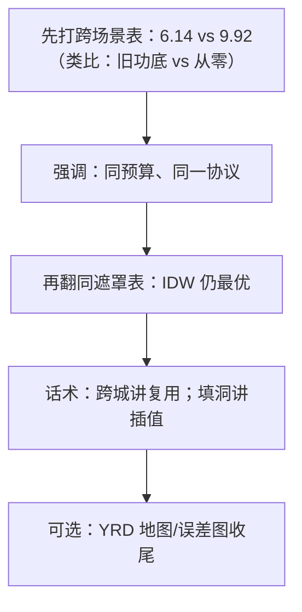
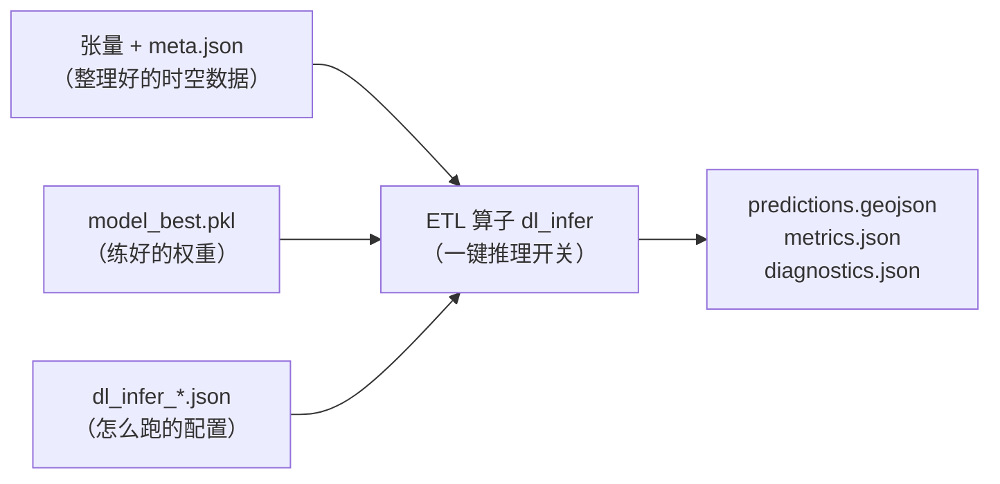
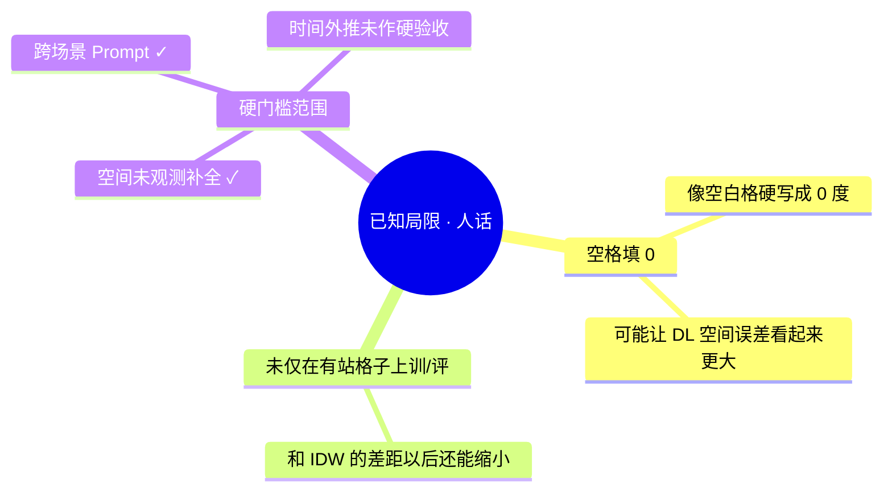

# 阶段 2 技术演示文稿（小白友好版）

> **一句话**：先在京津冀「练功」，再带到长三角「少练几下就能上手」——这叫跨区域复用；  
> 但若只是「附近有站、猜没站的点」，邻居加权（IDW）往往更稳。两种本事互补，不互相替代。  
> 选型：UniST（KDD 2024）· 数据：KnowAir BTHSA / YRD · 日期：2026-10-22  
> 精简版：[阶段2-演示说明.md](./阶段2-演示说明.md) · 计划：[阶段2-时空基础模型与预测计划.md](./阶段2-时空基础模型与预测计划.md)

---

## 读稿提示（给演示者）

| 听众 | 怎么讲 |
|------|--------|
| 非技术同事 / 领导 | 多讲「生活类比 + 结论表」，数字只留 2～3 个关键值 |
| 技术同事 | 类比过一遍后，再翻同遮罩表、工程命令 |
| 被追问「AI 是不是全面碾压」 | 明确说：**跨城复用赢了；单城填洞本期没赢过 IDW** |

---

## 目录（建议演示顺序）

| 节 | 时长建议 | 讲什么 |
|----|----------|--------|
| [0. 开场：用一句话说清](#0-开场用一句话说清) | 2 min | 生活例子 + 三句结论 |
| [1. 名词翻译 + 路线](#1-名词翻译--路线) | 3 min | 小白词典 → 流程图 |
| [2. Demo D1 站点填图](#2-demo-d1--站点填图猜没传感器的地方) | 4 min | 插值基线 + **看图说话** |
| [3. Demo D2 跨场景](#3-demo-d2--跨场景换一座城市还能不能用) | 4 min | Prompt vs Scratch（主胜利） |
| [4. 工程闭环](#4-工程闭环) | 1 min | 训练 → 评估 → 一键推理 |
| [5. Q&A 边界](#5-qa-边界) | — | 不夸大、可复现 |

---

## 0. 开场：用一句话说清

### 0.1 生活场景（先讲这个）

想象城市里很多**空气质量监测站**（像温度计），每隔一段时间报一次 PM2.5。

| 现实痛点 | 生活类比 | 我们在做什么 |
|----------|----------|--------------|
| 有的地方**没有站** | 小区没装温度计，想知道阳台几度 | **空间填洞**：用附近站的读数去猜 |
| 换一座城，不想从头训练 | 北京学会开车，到上海不想重新考科目一 | **跨场景复用**：旧城练好的模型，新城少调几下就能用 |
| 怎么证明猜得准 | 故意蒙住一部分真站，让模型猜，再对答案 | **hold-out 考试**：蒙住约 20% 站点再评估 |

### 0.2 本期三句结论

| 要证明的问题 | 生活版说法 | 本期结论 |
|--------------|------------|----------|
| 时空基础模型能否**跨区域**复用？ | 京津冀练功 → 长三角少样本适配，比从零学更省、更准 | **能。** Prompt 时间维 RMSE **6.14** vs Scratch **9.92** |
| 未观测空间补全能否压过经典插值？ | 「只看邻站猜空白点」这件事，老办法还很强 | **本期未压过。** 邻站充足时 **IDW / 克里金** 仍更强 |
| 工程能否闭环？ | 不是只出论文数字，而是能训练、评估、打包、一键推理 | **能。** 训练 → 同遮罩评估 → Demo → ETL `dl_infer` |

**对外话术（背这句就够）**：  
跨城讲「迁移复用」；单城填洞讲「IDW 作强基线」；**两者互补，不要说深度学习全面碾压插值**。

---

## 1. 名词翻译 + 路线

### 1.1 小白词典（演示时可贴旁注）

| 术语 | 一句话人话 | 生活例子 |
|------|------------|----------|
| **BTHSA / YRD** | 两个区域的空气站点数据 | 京津冀一带 vs 长三角一带 |
| **时空** | 既看「哪里」，也看「何时」 | 不光猜某个点的污染，还顺着时间变化学规律 |
| **掩码 / hold-out** | 故意藏起一部分答案当考题 | 蒙住 20% 站点，看模型能不能猜回来 |
| **IDW** | 越近的邻居说话权越大 | 猜你家温度：优先参考隔壁，少参考隔两条街 |
| **克里金（Kriging）** | 更「统计学」的插值，常更平滑 | 像看整片街区走势再猜，有时会抹平局部尖峰 |
| **MAE / RMSE** | 平均错多少 / 大错罚得更重 | MAE≈「平均偏了几度」；RMSE≈「偶尔大翻车会被狠扣分」 |
| **预训练（Stage-1）** | 先在大数据上练通用本事 | 先练「看图说话」基本功，再去做具体任务 |
| **Prompt / 少样本适配** | 带着旧功底，在新城只微调一点 | 会开车的人到新城市熟悉路况，不用重考驾校 |
| **Scratch（从零）** | 在新城从零开练 | 到上海重新从科目一学起（同预算对照） |
| **UniST** | 本期用的时空基础模型（论文方法） | 可理解为「专门学时空规律的深度学习主干」 |

> 指标口诀：**柱子 / 数字越矮（小）越好**——误差越小越准。

### 1.2 总体技术路线（流程图 + 人话）



**口述**：先把站点读数铺成网格 → 模型先练「蒙题猜答案」→ 换城时用 Prompt 少练几下 → 和经典插值同卷对比。

### 1.3 跨场景验收协议（书面定义）



**生活版**：在 A 城把基本功练扎实 → 带着功底去 B 城只适应几天 → 和「在 B 城从零学同样天数」比谁考得好；另外再单独考一科「纯空间猜空白点」，和 IDW 比。

### 1.4 两类 Demo 怎么分工



---

## 2. Demo D1 — 站点填图：猜「没传感器」的地方

**路径**：[`output/phase2/demo_d1/`](../output/phase2/demo_d1/)  
**设定**：KnowAir BTHSA，随机蒙住约 20% 站点（seed=42），只用剩下的站去猜蒙住站的 PM2.5。

**生活类比**：全市温度计里故意关掉 1/5，用其余温度计猜被关掉的读数——看哪种猜法更准。

### 2.1 经典基线数字（先记住）

| Method | MAE | RMSE | 人话 |
|--------|-----|------|------|
| **IDW** | **8.39** | **11.29** | 本期「邻居加权」最稳 |
| Ordinary Kriging | 9.80 | 12.61 | 更平滑，这组题上略逊 |

### 2.2 同遮罩 occupied-grid（含 UniST Long）

| Method | MAE | RMSE |
|--------|-----|------|
| **IDW** | **5.77** | **8.37** |
| Ordinary Kriging | 6.39 | 9.13 |
| UniST (Long) | 17.75 | 23.51 |

> **讲法**：D1 展示「空间缺测 → 插值填图」的基线实力；**深度学习不作本 Demo 的主胜利叙事**——留到 D2 讲跨城。

### 2.3 插图 · 看图说话

#### 图 A · 指标柱状图（MAE / RMSE）


| 看什么 | 怎么读 |
|--------|--------|
| **蓝柱 MAE / 橙柱 RMSE** | 都是「猜错了多少」；**越矮越好** |
| **IDW / Kriging（station）** | 在站点考试上误差相对小 → 「邻居猜法」靠谱 |
| **若图中有 UniST smoke 很高的柱** | 那是早期冒烟/未充分训练的对照，**不要当成最终结论**；正式同遮罩数字以 §2.2 表为准 |

**一句话**：这张图像成绩单——柱子矮 = 考得好；D1 故事主角是矮柱的 IDW。

#### 图 B · 站点 hold-out 空间分布


| 面板 | 看什么 | 人话 |
|------|--------|------|
| 左：Observed + hold-out | 实心点 = 看得见的站；青色圈 = 被蒙住的考题点 | 「哪些温度计被故意关掉了」 |
| 中：IDW at hold-out | 只在考题点上涂预测色 | IDW 猜出来的「污染深浅」 |
| 右：Kriging at hold-out | 同样只画考题点 | 克里金往往更「糊」、更平均，尖峰可能被抹平 |

**颜色**：黄偏干净 → 红偏脏（PM2.5 高）。演示时可用手指对比左图真值颜色与中/右图是否「同色系」。

#### 图 C · 预测 vs 真值散点


| 看什么 | 人话 |
|--------|------|
| **红虚线 y=x** | 「猜的 = 真的」完美线 |
| **点越贴这条线** | 猜得越准 |
| **若某方法的点横成一条** | 像「不管真值多少都答同一个平均数」——几乎没学到空间差异 |

**一句话**：散点是「对答案」；贴对角线 = 懂了，横条 = 瞎蒙平均数。

#### 图 D · Hold-out 误差空间分布


| 颜色 | 含义 |
|------|------|
| 接近白/浅灰 | 几乎猜对 |
| 偏红 | 猜高了（预测 − 真值 > 0） |
| 偏蓝 | 猜低了 |

**一句话**：左图若整体更「淡」，说明 IDW 在这张卷上翻车更少；右图若局部深蓝/深红成片，说明克里金在某些片区系统性偏了。

### 2.4 D1 演示流程（口述脚本）



---

## 3. Demo D2 — 跨场景：换一座城市还能不能用

**路径**：[`output/phase2/demo_d2/`](../output/phase2/demo_d2/)  
**主胜利**：跨场景 **Prompt 优于同预算 Scratch**。

**生活类比**：  
- **Prompt** = 在京津冀练好车技，到长三角只适应几天路况  
- **Scratch** = 到长三角从科目一重新学，但只给同样几天时间  
→ 本期结果：带着旧功底的人，考试分数明显更好。

### 3.1 跨场景 Prompt vs Scratch（主表，先打出）

| 设定 | Test temporal RMSE | Test temporal MAE | 人话 |
|------|--------------------|-------------------|------|
| **Prompt：BTHSA Long → YRD** | **≈ 6.14** | **≈ 2.23** | 带着旧功底，少样本适配 |
| Scratch：YRD 从零（同预算） | ≈ 9.92 | — | 同时间从零学，明显更差 |



相对冒烟 Prompt（RMSE≈14），长训权重跨场景**明显更强**，且仍优于从零训练。  
**演示口播**：先把 **6.14 vs 9.92** 打在屏幕上——这是本期最想让人记住的一对数字。

### 3.2 同遮罩对照（诚实展示，避免「全面碾压」）

| Method | MAE | RMSE |
|--------|-----|------|
| **IDW** | **4.02** | **5.65** |
| Ordinary Kriging | 4.72 | 6.50 |
| UniST (Prompt) | 17.13 | 20.77 |

> **诚实话术**：换城「迁移复用」我们赢了；但若题目改成「周围站很密、只做纯空间填洞」，IDW 仍更强。  
> **不要说**「深度学习全面碾压插值」——这张表不支持。

### 3.3 插图（YRD）· 看图说话

#### 图 E · 同遮罩指标柱状图


| 看什么 | 怎么讲 |
|--------|--------|
| 柱子高度 | 仍是误差；**越矮越好** |
| IDW / Kriging | 在「同遮罩空间填洞」卷上通常更矮 |
| 和 §3.1 主表的关系 | **两张不同的考卷**：主表考「跨城时间维复用」；本图考「同城空间蒙题」——结论可以不同，这很正常 |

**一句话**：别把这张图和 6.14 vs 9.92 混成同一句话；先讲迁移胜利，再翻这张诚实对照。

#### 图 F · 站点 / 网格 hold-out 分布（YRD）


| 面板 | 讲法（同 D1，换成长三角地图） |
|------|--------------------------------|
| 左 | 实心点可见、青圈蒙住 → 「考题在哪」 |
| 中 / 右 | IDW vs 克里金在考题点上的填色猜测 |

**加一句**：D2 的地图是在讲「空间卷长什么样」；**跨城胜利数字在 §3.1 表，不在这张地图的颜色里直接读出**。

#### 图 G · 预测 vs 真值散点


**看图要点（同 D1）**：贴红虚线 = 准；成横条 = 只会报均值。可用它快速判断「空间插值卷」上谁更像会做题的学生。

#### 图 H · Hold-out 误差地图


**看图要点**：白/浅 = 准；红 = 猜高；蓝 = 猜低。用来收尾「空间填洞上经典方法往往更淡、更稳」。

### 3.4 D2 演示流程（口述脚本）



---

## 4. 工程闭环

### 4.1 从数据到推理（人话版）



**口述**：数据说明书 + 模型体重 + 配置单 → 按一下算子 → 吐出预测地图和指标文件。说明「不是只能 notebook 里玩，而是能接进现有 ETL」。

### 4.2 产物落位

| 类型 | 位置 |
|------|------|
| 计划 / 演示文档 | `docs/阶段2-*.md` |
| 训练与评估脚本 | `examples/phase2/` |
| ML 推理 + ETL | `src/eda_toolkit/ml/` · `etl/registry.py`（`dl_infer`） |
| 权重 / 张量 / 图 | `third_party/UniST/` · `output/phase2/`（大文件不进 git） |
| TensorBoard 训练日志 | `third_party/UniST/src/logs/`（`events.out.tfevents*`） |
| Demo 固化目录 | `output/phase2/demo_d1` · `demo_d2` · `demo_INDEX.md` |

### 4.3 训练曲线回放（TensorBoard）

**口播一句**：这是**已跑完实验的回放**，不是现场重训——用来指「loss 怎么掉下来、Prompt 比 Scratch 更低」。

```powershell
# 打开全部已完成 run（默认 http://localhost:6006）
.\.venv-ml\Scripts\python.exe examples\phase2\launch_tensorboard.py

# 只看某一叙事
.\.venv-ml\Scripts\python.exe examples\phase2\launch_tensorboard.py --preset long
.\.venv-ml\Scripts\python.exe examples\phase2\launch_tensorboard.py --preset prompt
.\.venv-ml\Scripts\python.exe examples\phase2\launch_tensorboard.py --preset scratch
```

| 演示时点开 | 看什么 | 人话 |
|------------|--------|------|
| `Training/Loss_step` | 曲线整体往下 | 「练的时候错误在变少」 |
| `Test_RMSE/*`（Long） | 从高落到约 **12** | 「京津冀基本功从瞎猜练像样」 |
| `Test_RMSE/*`（Prompt vs Scratch） | Prompt 更低 | 「带着旧功底少练几下，比从零同预算更好」 |

### 4.4 验收命令速查

环境：仓库根目录，使用 `.venv-ml`。

```powershell
# Train（已跑通）
.\.venv-ml\Scripts\python.exe examples\phase2\run_unist_pretrain_long.py
.\.venv-ml\Scripts\python.exe examples\phase2\run_unist_prompt_cross.py --from-long --epochs 5 --also-scratch

# 训练曲线回放（TensorBoard）
.\.venv-ml\Scripts\python.exe examples\phase2\launch_tensorboard.py

# Infer / 同遮罩评估
.\.venv-ml\Scripts\python.exe examples\phase2\eval_same_mask.py --region yrd
.\.venv-ml\Scripts\python.exe -m eda_toolkit.cli.main operators execute dl_infer `
  -i output\phase2\tensors\knowair_bthsa_16x16_2022-01-01_2023-12-31.meta.json `
  -o output\phase2\op_dl_infer_bthsa `
  -p examples\config\dl_infer_bthsa_long.json

# 打包演示目录
.\.venv-ml\Scripts\python.exe examples\phase2\pack_demos.py
```

---

## 5. Q&A 边界

### 5.1 关键数字一览（被问到时翻）

| 实验 | 最优/结论侧 | 数值 | 生活版 |
|------|-------------|------|--------|
| BTHSA Long 预训练 tube | 相对冒烟大幅下降 | test tube RMSE ≈ **12**（冒烟 ≈95） | 基本功从「瞎猜」练到「像样」 |
| 跨场景 Prompt vs Scratch | **Prompt 胜** | temporal RMSE **6.14 vs 9.92** | 旧功底值钱 |
| 同遮罩 YRD | **IDW 胜** | RMSE ≈ **5.65**（UniST ≈20.8） | 密站填洞，邻居法仍强 |
| 同遮罩 BTHSA | **IDW 胜** | RMSE ≈ **8.37**（UniST ≈23.5） | 同上 |
| `dl_infer` 冒烟（BTHSA Long） | 算子可跑通 | MAE/RMSE ≈ 11.3 / 14.6（8 windows） | 工程开关能亮 |

原始 JSON：`output/phase2/eval/`；进度：`output/phase2/PROGRESS.md`。

### 5.2 已知局限（被问到时说）



### 5.3 演示禁忌

- 不要说「深度学习全面碾压插值」——同遮罩表不支持。
- 不要把冒烟数字（Prompt RMSE≈14）当成最终结论——用长训 **6.14**。
- D1 / D2 叙事不要混：D1 讲「邻居填洞基线」，D2 讲「跨城复用」。
- 讲图时先说「这张图考的是哪一科」（空间填洞 vs 跨城时间维），避免听众把柱状图和 6.14 混为一谈。

---

## 附录 · 文档与目录索引

| 文档 | 用途 |
|------|------|
| 本文 · [阶段2-技术演示文稿.md](./阶段2-技术演示文稿.md) | 小白友好完整演示稿（类比 + 看图说话） |
| [阶段2-演示说明.md](./阶段2-演示说明.md) | 一页总览（可投影 / 打印） |
| [阶段2-时空基础模型与预测计划.md](./阶段2-时空基础模型与预测计划.md) | 计划与验收清单 |
| [examples/phase2/README.md](../examples/phase2/README.md) | 环境与复现 |
| [output/phase2/demo_INDEX.md](../output/phase2/demo_INDEX.md) | Demo 目录索引 |
