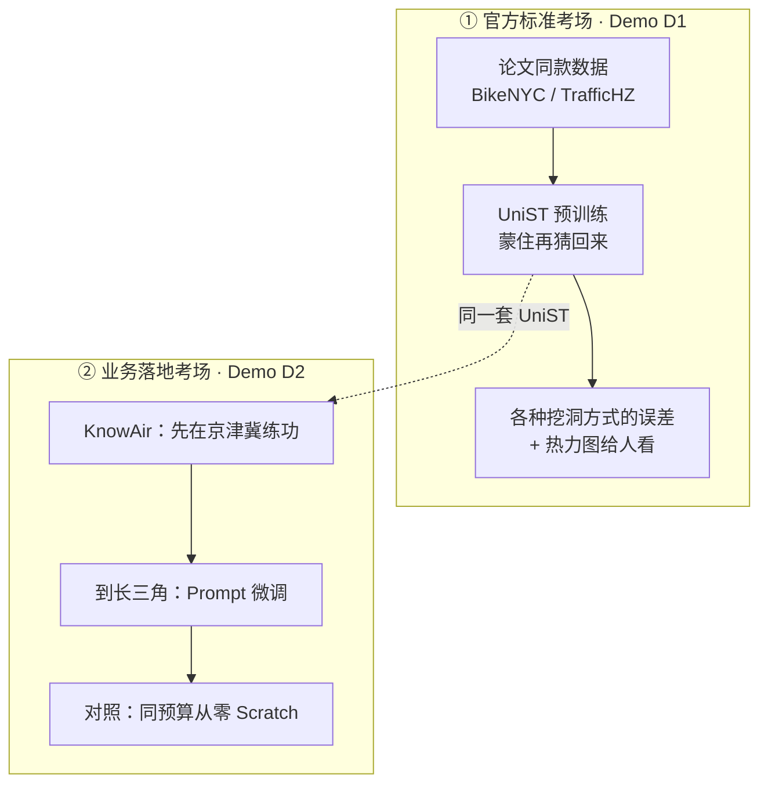
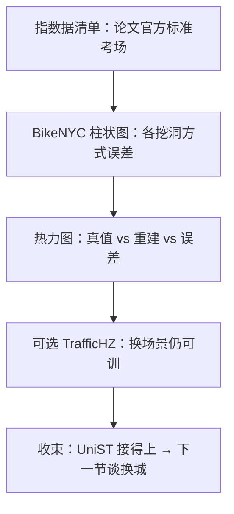
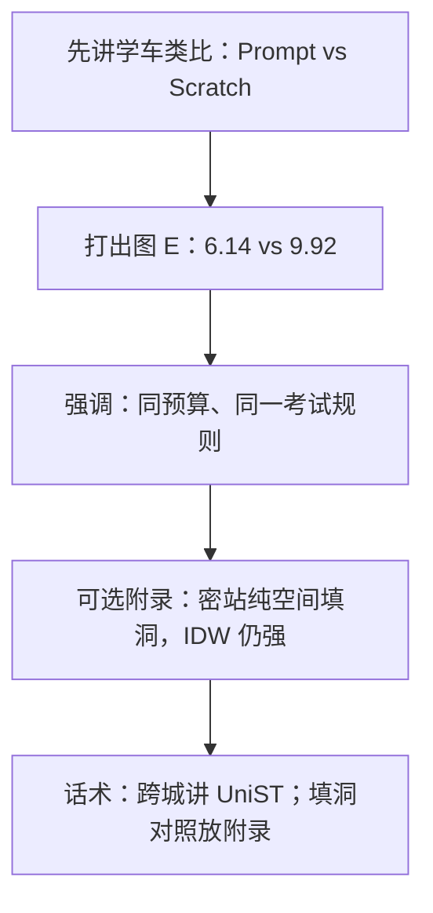

# 阶段 2 技术演示文稿（给小白也能听懂的版）

> **一句话（先背这个）**：  
> 我们接好了论文里的「万能时空模型」**UniST**——  
> ① 在论文官方场景上证明「这套东西真能跑」；  
> ② 在大气污染真实数据上证明「换一座城、数据不多时，带着旧功底比从零学划算」。  
> 经典填洞方法（IDW / 克里金）只作诚实附录，不是今天的主角。
>
> 选型：UniST（KDD 2024）· 官方 `data_release` + KnowAir 京津冀 / 长三角 · 日期：2026-10-23  
> 精简版：[阶段2-演示说明.md](./阶段2-演示说明.md) · 计划：[阶段2-时空基础模型与预测计划.md](./阶段2-时空基础模型与预测计划.md)

---

## 读稿提示（给演示者）

| 听众 | 怎么讲 |
|------|--------|
| **非技术同事 / 领导** | 少念术语，多讲故事：「同一套模型、两种本事」——官方场景能跑 + 换城少样本更准。数字只记一对：**6.14 vs 9.92** |
| **技术同事** | D1 看 mask 指标与热力图；D2 看 Prompt vs Scratch；附录里诚实讲 IDW |
| **被追问「是不是全面碾压插值」** | **不是。** 我们赢的是「跨城复用」这张考卷；「周围站很密、只做纯空间填洞」那张考卷，附录里 IDW 仍更强 |

**演示节奏建议**：开场用生活类比抓住注意力 → 再亮数字 → 最后才点技术名词。

---

## 目录（建议演示顺序）

| 节 | 时长 | 讲什么 |
|----|------|--------|
| [0. 开场](#0-开场先讲人话) | 3 min | 用外卖 / 学车类比说清「我们在干嘛」 |
| [1. 小白词典 + 路线](#1-小白词典--路线图) | 4 min | 术语 → 生活说法；两条 Demo 怎么分工 |
| [2. Demo D1](#2-demo-d1--证明这套模型真能跑) | 4 min | 官方场景：共享单车 / 杭州交通 |
| [3. Demo D2](#3-demo-d2--证明换城带着旧功底更划算) | 5 min | **主胜利：6.14 vs 9.92** |
| [4. 工程闭环](#4-工程闭环可复现不是口头说说) | 1 min | 命令与产物（可一笔带过） |
| [5. Q&A](#5-qa-边界诚实话术) | — | 附录 IDW、不做之事 |

---

## 0. 开场：先讲人话

### 0.1 我们到底在解决什么痛点？

想象公司业务要覆盖很多城市、很多场景：

| 现实里的麻烦 | 用一句话说 | 本期怎么对应 |
|--------------|------------|--------------|
| 每个城市、每种业务都从零建模型 | 像每开一家分店都重新招人、重新培训，又贵又慢 | **D1**：先证明有一套「通用功底」真能训起来 |
| 新城市数据少、时间紧、预算紧 | 像新员工只给三天试用期，却指望立刻上手 | **D2**：带着旧功底微调（Prompt），比从零学划算 |
| 领导要「能复现、能交付」 | 不是 PPT 上的概念，是能跑通的工程 | 第四节：训练 → 出图 → 打包 |

**总比喻（贯穿全场）**：

> UniST 像一位「见过世面的厨师」。  
> - **D1**：在标准菜谱（论文官方数据）上证明他确实会炒菜。  
> - **D2**：换到新餐厅（长三角），只给几天适应期——**带着旧厨艺微调**，比让新人从切菜学起更稳。

### 0.2 本期两句结论（对外只记这两句）

| 要证明的问题 | 人话结论 | 数字 / 证据 |
|--------------|----------|-------------|
| 接的是不是论文里那套 UniST？官方场景能不能训通？ | **能。** 不是我们自己瞎起名字 | Demo D1 图 + 指标 |
| 换一座城、数据不多时，旧功底有没有用？ | **有用。** 带着旧功底明显更好 | **6.14 vs 9.92**（越小越好） |

**对外话术（30 秒版）**：  
主角是 UniST；今天讲「跨城少样本复用」；经典插值是另一张考卷，放附录里诚实对照。

---

## 1. 小白词典 + 路线图

### 1.1 小白词典（术语 → 生活说法）

下面每个词，演示时都可以先说右列，再点一下左列「专业叫法」。

| 术语 | 人话 / 生活类比 | 记住什么就够了 |
|------|-----------------|----------------|
| **时空数据** | 既有「在哪」（空间），又有「什么时候」（时间）的数。例如：某网格某小时的单车量、某城市某天的空气质量 | 不是一张静态表，是「地图 × 时间轴」 |
| **UniST** | 「Universal Spatio-Temporal」——想当**多场景通用**的时空模型；本期选定的论文方案（KDD 2024） | 我们的主角名字 |
| **基础模型** | 像先通读很多城市的「生活规律」，练出通用感觉；以后换城不必从零 | 先通识，再特训 |
| **掩码 / Mask** | 考试时把一部分答案涂黑，逼模型根据周围线索猜回来 | 故意挖洞再填洞，练本事 |
| **Stage-1 预训练** | 蒙住时空块再猜回来——像玩「遮住一部分拼图再补全」 | 练通用补全能力 |
| **Prompt（本期用法）** | 带着京津冀练好的功底，到长三角**只微调一点**；像老司机换城市开几天适应路况 | **旧功底 + 少量新练习** |
| **Scratch（从零）** | 新场景从科目一重学；但只给和 Prompt **同样短**的练习时间 | 对照实验：同样预算、没旧功底 |
| **BikeNYC** | 纽约共享单车网格数据——论文官方「标准考场」之一 | D1 主场景 |
| **TrafficHZ** | 杭州交通网格——另一个官方考场 | D1 辅场景 |
| **KnowAir / BTHSA / YRD** | 大气污染公开数据：BTHSA≈京津冀一带，YRD≈长三角一带 | D2 业务落地数据 |
| **MAE** | 「平均错多少」——把每次误差取绝对值再平均 | 越小越好 |
| **RMSE** | 「大错罚更重」——大偏差会被平方放大再开方 | 越小越好；**本期主数字用 RMSE** |
| **IDW / 克里金** | 经典「看邻居猜这里」的空间插值；像用周围几个测站估没测到的点 | 附录对照，不是主角 |
| **热力图** | 把数值画成颜色深浅的地图；一眼看出哪里高、哪里低、哪里猜错了 | 给外行看的「证据图」 |

#### 再补一层：四种「挖洞方式」在考什么？

预训练时故意挖洞的方式不同，像考试题型不同：

| 挖洞方式 | 生活类比 | 和业务的关系 |
|----------|----------|--------------|
| **random** | 随机抠掉几块拼图 | 练基础补全 |
| **temporal** | 某几个时刻整片空白（时间维缺测） | 偏「时间上缺一段」 |
| **tube** | 某个位置整段时间都空（像一根管子竖着挖空） | 很像「某个区域长期没观测」 |
| **block** | 一整块区域一起空 | 很像「一片未建站 / 未覆盖的区域」 |

> 口播提示：管 / 块（tube / block）更贴近「未观测区域」故事，演示时可以多停两秒。

### 1.2 总体路线（一张图讲完）



**人话串讲**：  
先在论文标准菜谱上证明厨师会做菜（D1）；再带到我们自己的餐厅——大气污染跨城——看「老厨师适应几天」是否比「新人同样几天」更好（D2）。

### 1.3 两个 Demo 怎么分工（别混成一锅）


| Demo | 一句话使命 | 别在这一节讲什么 |
|------|------------|------------------|
| **D1** | 「这套东西在论文考场上能跑」 | 不要展开 IDW |
| **D2** | 「换城带着旧功底更准」 | 不要把附录空间填洞说成主胜利 |

---

## 2. Demo D1 — 证明这套模型真能跑

**路径**：[`output/phase2/demo_d1/`](../output/phase2/demo_d1/)  
**数据源**：`E:\数据分析模型训练数据\data_release`（经 `link_unist_paper_data.py` 接入）  
**设定**：BikeNYC（主）+ TrafficHZ（辅），短训 Stage-1，报告各 mask 策略重建误差。

### 2.0 用什么故事开场（30 秒）

> 做菜要先在「标准菜谱」上过关，别人才能信你接的是正宗配方。  
> D1 就是：用论文发布的官方网格数据，把 UniST 训通、出数、出图——证明我们接的是真 UniST，不是空壳名字。

### 2.1 讲法（四步，按顺序指图）

1. **指官方数据清单图**：这些是论文同款场景（标准考场）  
2. **打开 BikeNYC 柱状图**：不同挖洞方式下，误差柱子有多高（**越矮越好**）  
3. **打开重建热力图**：左边真值、中间模型猜的、右边猜错了多少——外行也能看懂「它在补全」  
4. **（可选）TrafficHZ**：换一个官方交通场景，同一套流程仍能出数  

**不要**在本节展开 IDW / 克里金。

### 2.2 插图

#### 图 A · 官方数据清单


**怎么讲**：蓝色条 = 本期 D1 实际训练过的数据集。像菜单上「今天确实做过」的几道菜。

#### 图 B · BikeNYC UniST mask 指标


| 看什么 | 怎么读（人话） |
|--------|----------------|
| 各 mask 柱高 | 猜错的程度；**越矮越好** |
| tube / block | 更贴近「整列 / 整块没观测」的业务故事 |
| 数字从哪来 | `demo_d1/metrics/paper_demo_bikenyc.md`（短训可演示，**不是**论文全量 SOTA 表） |

#### 图 C · BikeNYC 重建热力图


**怎么讲**：左 = 真实答案；中 = UniST 填出来的；右 = 差在哪。  
这是给非技术听众的「直观证据」：模型不是在背数字，而是在做时空补全。

#### 图 D · TrafficHZ（辅）


**一句话**：换一个官方交通场景，同一套 UniST 流程仍能出数——说明不是只对单车数据「碰巧有效」。

### 2.3 D1 口述脚本



**收束金句**：  
「D1 证明配方是正宗的；下一节证明：换一家店、只给几天适应期，老厨师仍然更划算。」

---

## 3. Demo D2 — 证明换城带着旧功底更划算

**路径**：[`output/phase2/demo_d2/`](../output/phase2/demo_d2/)  
**主胜利**：跨场景 **Prompt 优于同预算 Scratch**。

### 3.0 生活类比（本节开场必讲）

| 设定 | 类比 | 含义 |
|------|------|------|
| **Prompt** | 在京津冀把车技练熟了，到长三角只适应几天路况 | 旧功底 + 少量新练习 |
| **Scratch** | 到长三角从科目一重学，但**只给同样几天** | 没旧功底、同预算对照 |
| **RMSE 6.14 vs 9.92** | 同样考试，带着旧功底少错一大截 | **数字越小越好**；这是今天最该记住的一对 |

再补一个「考试」说法（适合领导）：

> 两个人参加同一场长三角测验，练习时间一样短。  
> 一个以前在京津冀刷过很多真题（Prompt），一个完全没刷过（Scratch）。  
> 结果：刷过的人分数明显更好——**旧功底值钱**。

### 3.1 主表（先打出，再解释）

| 设定 | Test temporal RMSE | Test temporal MAE | 人话 |
|------|--------------------|-------------------|------|
| **Prompt：BTHSA Long → YRD** | **≈ 6.14** | **≈ 2.23** | 带着旧功底微调 |
| Scratch：YRD 从零（同预算） | ≈ 9.92 | — | 同预算从零 |

**口播**：不是「Prompt 随便赢一点」，而是大约 **6.14 对 9.92**——同规则、同预算下，旧功底差距肉眼可见。

### 3.2 插图（先讲这两张）

#### 图 E · Prompt vs Scratch（主胜利）


**口播**：6.14 vs 9.92——带着旧功底明显更好。这是选型 UniST **最想让人记住**的一对数字。

#### 图 F · 一句话摘要卡


适合投屏停顿 5 秒，让听众自己读完再往下讲。

### 3.3 附录 · 同遮罩空间填洞（诚实对照）

> **先声明**：下面这张是**另一张考卷**，不是否定上面的主胜利。

| Method | MAE | RMSE | 人话 |
|--------|-----|------|------|
| **IDW** | **4.02** | **5.65** | 看邻居猜这里，这张考卷上更强 |
| Ordinary Kriging | 4.72 | 6.50 | 经典地统计插值 |
| UniST (Prompt) | 17.13 | 20.77 | 不是为「纯空间密站填洞」优化的主角设定 |

**诚实话术（建议原句念）**：

> 换城「迁移复用」我们赢了；  
> 若题目改成「周围测站很密、只做纯空间填洞」，IDW 仍然更强。  
> **两张不同考卷**，不要混成一句「深度学习全面碾压插值」。

可选附图（非主舞台）：


完整基线专档（协议 A/B、两城数字、站点图、复现命令）：  
[阶段2-经典插值基线实验-IDW与克里金.md](./阶段2-经典插值基线实验-IDW与克里金.md)

### 3.4 D2 口述脚本



**收束金句**：  
「今天主结论只有一句：跨城少样本时，带着旧功底比从零学划算。」

---

## 4. 工程闭环：可复现，不是口头说说

给技术同事或被追问「能不能复现」时用；非技术场次可一句话带过：「训练、出图、打包都有固定脚本和目录。」

### 4.1 产物落位

| 类型 | 位置 | 人话 |
|------|------|------|
| 演示文档 | `docs/阶段2-*.md` | 你正在看的讲稿 |
| 脚本 | `examples/phase2/link_unist_paper_data.py` · `run_unist_paper_demo.py` · `plot_unist_demo_figures.py` · `pack_demos.py` | 一键联数据 / 训练 / 出图 / 打包 |
| 官方数据源 | `E:\数据分析模型训练数据\data_release` | 论文同款数据放哪 |
| 权重 / 日志 | `third_party/UniST/src/experiments/` · `logs/` | 模型练完存在哪 |
| Demo 固化 | `output/phase2/demo_d1` · `demo_d2` | 演示用「成品货架」 |

### 4.2 验收命令

```powershell
# D1：联数据 → 短训 → 出图
.\.venv-ml\Scripts\python.exe examples\phase2\link_unist_paper_data.py
.\.venv-ml\Scripts\python.exe examples\phase2\run_unist_paper_demo.py --also-hz --epochs 3
.\.venv-ml\Scripts\python.exe examples\phase2\plot_unist_demo_figures.py

# D2（已有结果可跳过训练）
.\.venv-ml\Scripts\python.exe examples\phase2\run_unist_prompt_cross.py --from-long --epochs 5 --also-scratch

# 打包
.\.venv-ml\Scripts\python.exe examples\phase2\pack_demos.py

# 训练曲线回放
.\.venv-ml\Scripts\python.exe examples\phase2\launch_tensorboard.py
```

---

## 5. Q&A 边界：诚实话术

### 5.1 关键数字速查卡

| 实验 | 人话结论 | 数值 |
|------|----------|------|
| 跨场景 Prompt vs Scratch | **带着旧功底更好** | **6.14 vs 9.92** |
| KnowAir Long tube | 预训练有效（练过 vs 几乎没练） | ≈ **12**（冒烟 ≈95） |
| D1 官方短训 | 能演示、能出图 | 见 `paper_demo_*.md` |
| 同遮罩 YRD（附录） | 纯空间密站填洞，IDW 更强 | 5.65 vs UniST ≈20.8 |

### 5.2 演示禁忌（踩了就翻车）

| 别说 / 别做 | 为什么 | 改成怎么说 |
|-------------|--------|------------|
| 「深度学习全面碾压插值」 | 附录数字会打脸 | 「跨城复用我们赢；纯空间填洞另一张考卷」 |
| 「D1 短训 = 论文全量 SOTA」 | 我们是可演示短训 | 「证明接得上、能训通，不是刷榜全文」 |
| 让 IDW 地图占满 D1 主舞台 | 抢戏、混淆主线 | IDW 只放 D2 附录 |
| 不说明「这张图考哪一科」 | 听众会把不同实验混在一起 | 先说：官方重建 / 跨城时间维 / 附录空间填洞 |

### 5.3 被追问时的短答模板

| 问题 | 建议答法（可直接念） |
|------|----------------------|
| UniST 是什么？ | 一篇 2024 年顶会工作里的多场景时空基础模型；我们把它接到官方数据上训通，又接到大气污染跨城任务上验证。 |
| Prompt 是不是很玄？ | 不玄。就是「旧城市练好的模型，到新城市只微调一点」，对照是「同预算从零练」。 |
| 为什么还要经典插值？ | 因为业务里「站很密、只填空间洞」仍然常见；我们诚实对照，不假装一种方法包打天下。 |
| 下一步做什么？ | 官方 few-shot / zero-shot 完整复现；更多数据集联合预训练——见下表。 |

### 5.4 下一步（未本期做）

- 官方 `few_shot.sh` / `zero_shot.sh` 完整复现  
- Crowd / Cellular 等更多官方数据集的联合预训练  

---

## 附录 · 文档索引

| 文档 | 用途 |
|------|------|
| 本文 | UniST 优先完整演示稿（含生活类比、小白词典） |
| [阶段2-演示说明.md](./阶段2-演示说明.md) | 一页总览（给要极简版的人） |
| [阶段2-经典插值基线实验-IDW与克里金.md](./阶段2-经典插值基线实验-IDW与克里金.md) | IDW / 克里金同遮罩与站点 hold-out 专档 |
| [阶段2-时空基础模型与预测计划.md](./阶段2-时空基础模型与预测计划.md) | 计划与验收 |
| [examples/phase2/README.md](../examples/phase2/README.md) | 环境与复现 |
| [output/phase2/demo_INDEX.md](../output/phase2/demo_INDEX.md) | Demo 目录索引 |

---

## 附录 · 演示者「口袋金句」（可打印）

1. **总比喻**：UniST 像见过世面的厨师——先过标准菜谱（D1），再换店少样本适应（D2）。  
2. **主数字**：跨城 **6.14 vs 9.92**（越小越好；带着旧功底更划算）。  
3. **诚实边界**：两张考卷——跨城复用我们赢；密站纯空间填洞，IDW 仍强。  
4. **禁忌一句**：绝不说「全面碾压插值」。  
