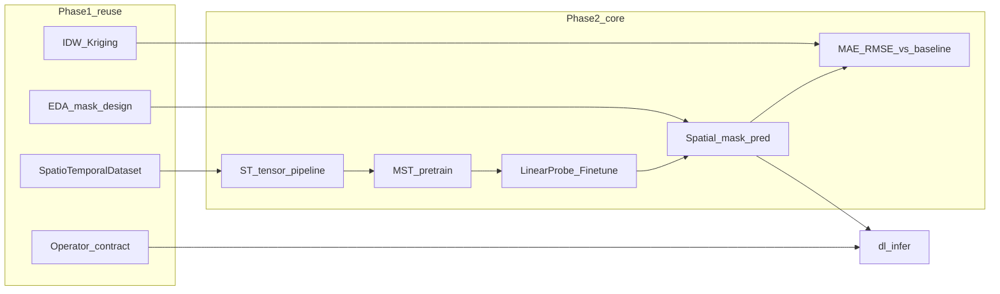

# 阶段 2 — 时空基础模型与未观测预测计划

> 对应年度计划「深度学习时空数据挖掘 / 基础模型跨场景理解 / 未观测区域预测」  
> 选型定案：**1A（站点点 + 区县/网格面）** + **2B（基础模型优先，预测作下游）**  
> 文档版本：v1.4 | 日期：2026-10-22 | **M2–M4 技术交付已完成**  
> **W1 选型定案**：UniST（KDD 2024）——详见附录 A  
> **环境**：`.venv-ml` + RTX 3060 / `torch 2.6.0+cu124`——见 `examples/phase2/README.md`  
> **进度 / 演示**：见 `output/phase2/PROGRESS.md` · **[阶段2-演示说明.md](./阶段2-演示说明.md)**

相关文档：

- [技术路线-时空数据分析挖掘.md](./技术路线-时空数据分析挖掘.md)（总路线）
- [阶段1.2-经典算法交付说明.md](./阶段1.2-经典算法交付说明.md)（基线：IDW / 克里金 / LISA）
- [etl_operators.md](./etl_operators.md)（算子契约，含 `dl_infer`）
- [阶段2-演示说明.md](./阶段2-演示说明.md)（Demo + 结论一页总览，M4）

---

## 1. 目标与范围

### 1.1 计划表对应目标

| 里程碑 | 日期 | 目标 |
|--------|------|------|
| 训练/推理管线 | **11 月 30 日** | 基于可复现论文/开源基础，完成时空表征模型与下游预测管线 |
| 两类技术演示 | **12 月 20 日** | 站点填图 + 面指标补全 两类 Demo，完成技术验证展示 |

### 1.2 本期做什么

1. **时空基础模型（优先）**  
   - 在多区域站点/面面板上做 Masked Spatio-Temporal 预训练（或加载可复现预训练权重）。  
   - 用 **线性探测 / 轻量微调** 验证「跨场景理解」（区域 A 预训练 → 区域 B 探测）。
2. **未观测区域预测（下游）**  
   - 空间遮罩（hold-out 站点或面单元）补全。  
   - 与阶段 1.2 **IDW / 普通克里金** 对比 MAE/RMSE。  
   - 可选：模型残差做 Moran/LISA 诊断。
3. **工程衔接**  
   - 张量构造对齐 `SpatioTemporalDataset`。  
   - ETL 预留 `dl_infer` 算子，契约与现有算子一致。

### 1.3 本期不做什么（范围控制）

| 排除项 | 原因 |
|--------|------|
| 自研大规模基础模型从零预训练（亿级参数、海量数据） | 工期与算力不匹配；以可复现 + 探测/微调满足计划表述 |
| 以 SatMAE 等纯遥感栅格模型为主干 | 与选型 **1A**（站点+面）不匹配；栅格 Demo 列入 v2.1 |
| 时间外推作为 12/20 硬门槛 | 加分项；硬门槛为**空间未观测补全** |
| 替换阶段 1 EDA/经典算法 | 阶段 2 复用，不重写 |

---

## 2. 选型定案（1A + 2B）

### 2.1 数据形态（1A）

| 类型 | 形态 | Demo 角色 |
|------|------|-----------|
| 环境/气象站点 | 点 + 时间 + 数值（如 PM2.5、气温） | **D1 站点填图** |
| 区县或规则网格指标 | 面/网格面板（如 GDP、均值污染物） | **D2 面指标补全** |

数据来源优先级：开源公开集 → 合成/扩展现有 `examples/data` → 采购数据（见第 6 节清单）。

### 2.2 技术优先级（2B）

```text
UniST 掩码预训练（Stage-1）
·        ↓
知识引导 Prompt 适配 / 少样本微调（Stage-2，跨场景）
        ↓
下游：空间遮罩预测（未观测区域；对齐 Tube/Block）
        ↓
对比 IDW / 克里金 + 出 Demo
```

「跨场景理解」的**可演示定义**（本期验收用语）：

> 在区域（或时段）A 上完成 UniST 预训练；在区域 B 上仅做 Prompt tuning 或少量微调，完成空间遮罩补全，并报告相对从零训练 / 经典基线（IDW、克里金）的指标差异。

---

## 3. 方法与模型定案

### 3.1 表征主干（已定：UniST）

- **选定模型**：UniST（Universal Spatio-Temporal Model）
- **结构**：时空 patching + Transformer Encoder–Decoder；预训练为 Masked Token Modeling；下游以知识引导 Prompt 适配。
- **预训练掩码**：随机 / Tube（整格时间缺失）/ Block（整块空间缺失）/ 时间掩码——其中 Tube/Block 直接支撑「未观测区域」叙事。
- **数据接口倾向**：原生 `T×C×H×W` 网格；D2 面/网格可直接对齐；D1 站点需栅格化或聚合到规则网格后再入模。
- **不首选**：纯遥感 MAE（SatMAE）、纯图像骨干——除非后续单列栅格 Demo。
- **保底**：若官方仓库在目标环境无法按时复现，启用最小自研 MST-Encoder（同掩码重建范式），见附录 A。

### 3.2 论文与开源短名单 → W1 已收敛

| 候选方向 | 适配 1A | 本期结论 |
|----------|---------|----------|
| **UniST / 多场景 ST 预训练** | 中高（D2 高；D1 需栅格化） | **已选定** |
| Spatio-Temporal Transformer / Masked ST 重建 | 高 | 作为自研保底范式 |
| 图时空网络（ST-GCN / Graph WaveNet 类）+ 预训练头 | 高 | 本期不采用；邻接图可作后续增强 |
| EarthPT / SatMAE | 低（本期） | 偏遥感；留作 v2.1 |

**W1 出口（已完成）**：论文 + 开源仓库已锁定，详见附录 A。

### 3.3 下游与基线

| 组件 | 做法 |
|------|------|
| 下游头 | 在编码器上接回归头，预测被遮罩位置的值 |
| 遮罩策略 | 随机站点/面单元 hold-out；固定种子可复现；比例可配置（如 20%） |
| 经典基线 | `idw_interpolate`、`ordinary_kriging`（仅用未遮罩观测拟合，再在遮罩位置评估） |
| 可选诊断 | 预测残差 → `areal_autocorr` / Moran |

### 3.4 评估指标

- 主指标：MAE、RMSE（遮罩位置）  
- 可选：相对基线提升百分比；CrPS（若输出分布）  
- 跨场景：区域 B 上「预训练+探测」vs「随机初始化+同预算训练」

---

## 4. 与阶段 1 的衔接



| 阶段 1 能力 | 阶段 2 用法 |
|-------------|-------------|
| `SpatioTemporalDataset` | 统一读入 → 张量/图构造入口 |
| Profile / 单变量 EDA | 设计遮罩比例、发现异常站、定时间窗 |
| IDW / 克里金 | 基线与 Demo 对照曲线 |
| Moran / LISA | 残差空间结构诊断（可选） |
| `SpatioTemporalOperator` | `dl_infer`：input_path + params → artifacts + diagnostics |

---

## 5. 目标工程结构（实现阶段再建，本文先定落位）

```text
src/eda_toolkit/
  ml/                      # 阶段 2 新增
    data/                  # Dataset → 张量 / 邻接图；遮罩采样
    models/                # MST-Encoder、预测头
    train/                 # 预训练 / 微调入口（CLI 或 scripts）
    eval/                  # 遮罩评估、基线对比表导出
  etl/registry.py          # 注册 dl_infer（推理；训练保持脚本侧）
examples/phase2/
  README.md                # 数据下载与复现说明
  configs/                 # 预训练 / 探测 / Demo 配置 JSON
  run_demo_d1_stations.py
  run_demo_d2_areal.py
output/phase2/             # 权重、指标、图（gitignore 大文件）
docs/阶段2-时空基础模型与预测计划.md
```

依赖建议（实现时写入 `pyproject.toml` extras，例如 `[ml]`）：

- `torch`（CUDA 版按 GPU 环境安装）
- 可选：`pytorch-lightning` 或精简自写训练循环

---

## 6. 数据与 GPU 检查清单

### 6.1 数据

| 项 | 状态 | 说明 |
|----|------|------|
| D1 开源站点面板候选 | 待定 | 如公开空气质量/气象站时序；需多区域以便跨场景 |
| D2 开源面/网格面板候选 | 待定 | 区县社会经济或网格化环境均值 |
| 采购数据 | 外部依赖 | 与计划「采购部分数据」对齐；到位前用开源+合成 |
| 许可与脱敏 | 待确认 | 入库前检查分享与展示范围 |
| CRS / 时间对齐 | 沿用阶段 1 | 投影到米制做图邻接；时间统一为 `DatetimeIndex` |

### 6.2 GPU 与环境

| 项 | 状态 | 说明 |
|----|------|------|
| GPU 机器/配额 | **已具备** | 本机 RTX 3060 12GB；训练用 `.venv-ml` |
| CUDA / 驱动 | **已锁定** | Driver 560.94 / CUDA 12.6；`torch 2.6.0+cu124` + `torchvision 0.21.0+cu124`（见 `examples/phase2/README.md`） |
| 权重存储 | 待定 | 本地 `output/phase2/checkpoints/`；大文件不进 git |

---

## 7. 两类 Demo 设计（12/20）

| Demo | 数据 | 流程 | 展示产物 |
|------|------|------|----------|
| **D1 站点填图** | 点 + 时间 | 遮罩部分站点 → MST 预测 vs IDW/克里金 | 指标 JSON、对照表、填图 GeoJSON/图 |
| **D2 面指标补全** | 面/网格面板 | 遮罩部分区域；跨区域探测或同域补全 | 指标表、LISA/残差图（可选）、摘要 Markdown |

跨场景最小叙事（二选一写进 Demo 说明即可）：

1. 区域 A 预训练 → 区域 B 线性探测；或  
2. 多区域混合预训练 → 留一区域探测。

---

## 8. 里程碑与周计划

| 节点 | 时间 | 交付 |
|------|------|------|
| W1 | 本周起 | ✅ UniST；数据/GPU；文档 |
| M1 | ~11/15 | ✅ 张量 + 冒烟预训练；✅ 跨场景 Prompt 出数 |
| **M2** | **11/30** | ✅ 加长训练 + 同遮罩基线表 + `dl_infer`（提前完成） |
| M3 | ~12/10 | ✅ D1、D2 与 `output/phase2/demo_*` 固化 |
| **M4** | **12/20** | ✅ 两类 Demo + [演示说明](./阶段2-演示说明.md)（提前完成） |

### 建议工作分解

1. **数据与张量**：`SpatioTemporalDataset` → `(N, T, C)` / 图边；遮罩采样器。  
2. **模型**：MST-Encoder + 重建损失；保存 checkpoint。  
3. **探测/微调**：冻结编码器训头；记录超参。  
4. **评估**：同一遮罩下 DL vs IDW vs Kriging。  
5. **ETL**：`dl_infer` 加载权重，写出预测 GeoJSON + `diagnostics`.  
6. **Demo 包装**：一键脚本 + 结果目录。

---

## 9. 验收标准

### 9.1 11 月 30 日

- [x] 一条命令（或明确两步：train / infer）可完成：数据 → 权重 → 遮罩预测 → `metrics.json`  
  - train：`run_unist_pretrain_long.py` / `run_unist_prompt_cross.py`；infer：`eval_same_mask.py` 或 `operators execute dl_infer`（见 [演示说明 §4](./阶段2-演示说明.md)）
- [x] 存在与 IDW、克里金的对比表（同一数据、同一遮罩种子）  
  - `eval_same_mask.py` → `output/phase2/eval/same_mask_{yrd,bthsa}_seed42.json`；已打入 Demo
- [x] 代码落在约定目录；关键超参可配置（JSON）  
  - `src/eda_toolkit/ml/` · `examples/phase2/` · `examples/config/dl_infer_*.json`

### 9.2 12 月 20 日

- [x] D1、D2 各有可展示产物目录 — `output/phase2/demo_d1` · `demo_d2`
- [x] 书面说明「跨场景」如何验证（区域划分与指标） — [阶段2-演示说明.md §2 D2](./阶段2-演示说明.md)（BTHSA→YRD；temporal RMSE；Prompt vs Scratch）
- [x] `dl_infer` 算子可被 `steda operators list` 发现（`preset=bthsa_long|yrd_prompt`；见 `docs/etl_operators.md`）

### 9.3 质量底线

- [x] 固定随机种子；评估脚本可重复得到相近指标（`seed=42` 等写入 JSON）
- [x] 不将训练日志/大权重提交进 git（`output/` · `third_party/` gitignore）
- [x] 经典基线调用现有阶段 1.2 API，避免重复实现插值

---

## 10. 风险与缓解

| 风险 | 影响 | 缓解 |
|------|------|------|
| GPU/采购数据延期 | 无法按期出可比指标 | 先开源小样本 + CPU 冒烟；Demo 标注数据版本 |
| 选定论文代码不可复现 | W1 延误 | 预备「最小自研 MST-Encoder」作为保底 |
| 跨场景提升不显著 | 叙事弱 | 仍交付完整管线 + 基线对比；诚实报告；强调工程闭环 |
| 与治理平台对接不清 | ETL 验收歧义 | 先保证算子契约与 CLI；平台 DAG 封装单列对接任务 |
| 范围膨胀（扩散模型/零样本 SOTA） | 拖垮 12/20 | 严格按第 1.3 节排除项执行 |

---

## 11. 立即可以开始的第一步（怎么开工）

1. **本周**：~~短名单收敛~~ 已定 UniST；clone 仓库并 pin commit 回填附录 A；列出 D1/D2 字段与栅格化协议。  
2. **确认 GPU** 与 PyTorch CUDA 版本；建 `examples/phase2/README.md`（含 UniST 依赖与复现命令）。  
3. **实现顺序**：KnowAir → `T×C×H×W` → UniST 预训练冒烟 → Prompt → 空间遮罩评估 vs IDW/克里金。  
4. **不要先做**：UI 大改、栅格 SatMAE、从零超大模型、全量 20+ 场景复现。

---

## 附录 A. 最终选型记录（W1 定案 · UniST）

> 定案日期：2026-10-21｜状态：**模型已锁定；环境就绪；UniST 已 pin；栅格协议 v1 已落地；KnowAir→UniST 冒烟预训练已跑通；BTHSA+YRD 数据齐全**。

| 项 | 填写 |
|----|------|
| 选定论文 | Yuan et al., **UniST: A Prompt-Empowered Universal Model for Urban Spatio-Temporal Prediction**, KDD 2024；arXiv:[2402.11838](https://arxiv.org/abs/2402.11838) |
| 开源仓库 | [tsinghua-fib-lab/UniST](https://github.com/tsinghua-fib-lab/UniST)（PyTorch；含 short/long/few-shot/zero-shot 脚本） |
| 锁定 commit | `third_party/UniST` @ `6ee69db00d8f67e550f9bc3c06f004f9f7885703`（`Update DataLoader.py`，shallow clone 2026-10-22） |
| 选用理由 | ① 多场景预训练 + Prompt，贴合「跨场景理解」；② Tube/Block 掩码天然支撑空间未观测补全；③ 论文+可跑代码，工期可控；④ 与 2B（基础模型优先，预测作下游）一致 |
| 训练范式（本期） | **Stage-1** 掩码预训练（可多区域/多数据集）→ **Stage-2** 知识引导 Prompt tuning → 空间 hold-out 评估 vs IDW/克里金 |
| 与 1A 数据形态衔接 | **D2（面/网格）**：直接构造 `T×C×H×W`；**D1（站点）**：站点→规则网格（聚合/插值）后再入 UniST；对比基线仍在原始点/面上算 IDW、克里金 |
| 自研保底是否启用 | **默认否**；仅当 UniST 仓库无法在 GPU 环境按期复现时启用最小 MST-Encoder（同掩码重建），并在本表注明切换日期 |
| D1 数据集 | **主候选**：KnowAir v2 站点面板（已有 `examples/phase2/data/knowair_v2/`：`stations_bthsa.csv` / `stations_yrd.csv` + `dataset_bthsa.nc`）；跨场景用 BTHSA ↔ YRD 划分。最终字段与时间窗实现时固化 |
| D2 数据集 | **主候选**：将 D1 站点时序聚合/插值到规则网格面板（与 UniST 原生接口一致）；若另有开源区县/网格指标到位则替换并更新本栏 |
| 跨场景验收定义 | 区域 A（如 BTHSA）预训练 → 区域 B（如 YRD）Prompt/少样本适配后做空间遮罩补全；报告相对「随机初始化同预算」及 IDW/克里金的 MAE/RMSE |
| GPU 型号与可用时段 | **RTX 3060 12GB**（本机）；Driver 560.94 / CUDA 12.6；环境 `.venv-ml`；`torch 2.6.0+cu124` + `torchvision 0.21.0+cu124` + `timm 0.9.2`；自检见 `examples/phase2/verify_env.py` |
| 已知风险与缓解 | 官方预训练权重可能需自训 → 先单数据集小规模预训练冒烟；D1 非网格 → 固定一种栅格化协议并版本化；全量多数据集预训练过重 → 本期以 2 区域讲清跨场景即可；`pip install -e .` 可能覆盖 CUDA torch → 按 README 第 5 步重装 |

---

## 附录 B. 与年度计划原文映射

| 计划表述 | 本期落点 |
|----------|----------|
| 时空基础模型具备跨场景理解能力 | UniST 多区域预训练 + 目标区域 Prompt / 少样本适配 |
| 未观测区域时空预测方法 | UniST Tube/Block 类空间遮罩补全 + 与 IDW/克里金对比 |
| 11/30 基于论文与既有基础实现 | UniST（KDD’24）开源复现 + 阶段 1 数据与基线 |
| 12/20 两类数据分析挖掘技术验证 | D1 站点 + D2 面/网格 Demo |
| GPU 支持 / 采购数据 | 第 6 节检查清单（外部依赖） |

---

*本文档为阶段 2 执行与汇报依据；实现过程中若调整模型或数据，请更新附录 A 并在文首提高版本号。*
