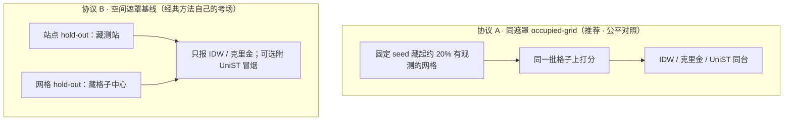
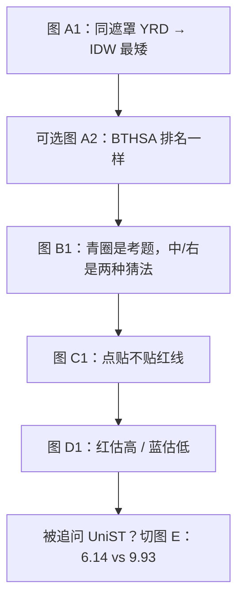

# 阶段 2 · 经典插值基线实验（IDW / Ordinary Kriging）

> **一句话**：在 KnowAir 大气污染数据上，用「故意藏起一部分观测点 / 网格，再用邻居猜回来」的方式，  
> 把 **IDW** 与 **普通克里金（Ordinary Kriging）** 跑成可复现基线；并与 UniST 做**同遮罩**诚实对照。  
> **主结论**：纯空间密站填洞这张考卷上，**IDW 最强**；这不否定 UniST 的跨城 Prompt 主胜利（另一张考卷）。
>
> 日期：2026-10-23 · 数据：KnowAir BTHSA（京津冀一带）/ YRD（长三角一带）· seed=42 · holdout≈20%  
> UniST 主演示稿：[阶段2-技术演示文稿.md](./阶段2-技术演示文稿.md) · 算法实现：[阶段1.2-经典算法交付说明.md](./阶段1.2-经典算法交付说明.md)

---


|     |
| --- |


---

## 0. 为什么单独整理这份文档？

阶段 2 演示里，经典插值只放在 UniST 文稿的「附录」，容易被一笔带过。  
但工程上我们已经完整跑通了两套协议、固化了指标与图——**值得单独成文**，方便：


| 用途      | 说明                    |
| ------- | --------------------- |
| 汇报 / 答辩 | 被问「有没有经典基线」时，直接打开本文   |
| 诚实对照    | 讲清「两张考卷」，避免「深度学习全面碾压」 |
| 复现      | 命令、产物路径、精确数字一处查齐      |


**和 UniST 文稿的分工**：


| 文档                               | 主角        | 主结论                                    |
| -------------------------------- | --------- | -------------------------------------- |
| [阶段2-技术演示文稿.md](./阶段2-技术演示文稿.md) | UniST     | 跨城 Prompt **6.14** vs Scratch **9.92** |
| **本文**                           | IDW / 克里金 | 同遮罩纯空间填洞：**IDW RMSE ≈ 5.65（YRD）**      |


---

## 1. 小白词典（这两种方法在干嘛）


| 术语                          | 人话 / 生活类比                                | 本期怎么用                            |
| --------------------------- | ---------------------------------------- | -------------------------------- |
| **空间插值**                    | 有的地方测了、有的地方没测；用「周围已测点」估没测到的位置            | 故意藏起约 20% 点/格，再估回来打分             |
| **IDW**（反距离权重）              | **离得越近的邻居，说话权越大**；像问附近几家店「今天空气怎么样」，近的店更信 | 默认 power=2                       |
| **Ordinary Kriging**（普通克里金） | 不只看远近，还看「空间相关衰减有多快」；像带统计规矩的加权平均          | PyKrige，`variogram_model=linear` |
| **hold-out**                | 考试前先藏起一部分答案，再用模型猜，和真值比                   | seed=42，可复现                      |
| **MAE / RMSE**              | 平均错多少 / 大错罚更重；**越小越好**；单位 PM2.5 μg/m³    | 柱状图主看柱高                          |
| **同遮罩**                     | IDW、克里金、UniST **猜同一批被藏起来的格子**，才算公平       | `eval_same_mask.py`              |
| **散点贴对角线**                  | 横轴真值、纵轴预测；点越贴红色 `y=x` 线越准                | 图 C 系列                           |
| **误差地图红蓝**                  | 红 = 猜高了，蓝 = 猜低了，浅色 = 几乎猜对                | 图 D 系列                           |


**一句对比**：

> IDW = 「近的邻居更重要」；  
> 克里金 = 「近的邻居更重要，但还要按空间相关结构调权重」。  
> 两者都是**单帧纯空间**方法——不利用「前后时刻」的时间信息。

---

## 2. 两套实验协议（别混）




| 协议         | 脚本                            | 考什么                        | 对应插图            |
| ---------- | ----------------------------- | -------------------------- | --------------- |
| **A 同遮罩**  | `eval_same_mask.py`           | 同一批 occupied holdout cells | **图 A1 / A2**   |
| **B 空间遮罩** | `eval_spatial_mask.py` + 出图脚本 | 站点 / 网格 hold-out           | **图 B / C / D** |


> 口播：对外优先讲协议 A + 图 A1；想展示「经典方法长什么样」再翻 B/C/D。

---

## 3. 协议 A · 同遮罩 occupied-grid（主表）

### 3.1 设定（人话版）

1. 在 KnowAir 栅格上，只看「有站点落入」的 occupied 格子。
2. 用 seed=42，随机藏起约 **20%** 的 occupied 格子。
3. **每一帧**：用剩下的格子做 IDW / 克里金，预测被藏格子的 PM2.5。
4. UniST：把这些格子映射到 tube patch，强制掩码后重建，再在**同一批格子**上打分。
5. 指标还原到原始 PM2.5 单位（MinMax inverse）。


| 区域        | UniST 权重角色               | occupied hold 格数 | 评估窗数 | 打分样本 n |
| --------- | ------------------------ | ---------------- | ---- | ------ |
| **YRD**   | Prompt（BTHSA Long → YRD） | 10 / 51          | 24   | 2880   |
| **BTHSA** | Long Stage-1             | 14               | 24   | 4032   |


### 3.2 结果表（精确值来自 eval JSON）

#### YRD（长三角 · Prompt 权重）


| Method           | MAE      | RMSE     | n    |
| ---------------- | -------- | -------- | ---- |
| **IDW**          | **4.02** | **5.65** | 2880 |
| Ordinary Kriging | 4.72     | 6.50     | 2880 |
| UniST (Prompt)   | 17.13    | 20.77    | 2880 |


#### BTHSA（京津冀 · Long 预训练）


| Method           | MAE      | RMSE     | n    |
| ---------------- | -------- | -------- | ---- |
| **IDW**          | **5.77** | **8.37** | 4032 |
| Ordinary Kriging | 6.39     | 9.13     | 4032 |
| UniST (Long)     | 17.75    | 23.51    | 4032 |


**人话结论**：

> 周围有观测、题目是「这一帧里猜被藏的格子」时，**近邻插值很难被掩码重建压过**——两城都是 IDW 第一、克里金第二。  
> 这是预期内结果，不是实验翻车。

### 3.3 插图详解（协议 A）

#### 图 A1 · YRD 同遮罩柱状图（主结论图）


| 讲解维度       | 内容                                                                                                               |
| ---------- | ---------------------------------------------------------------------------------------------------------------- |
| **这张图是什么** | 长三角（YRD）上，三种方法在**同一批被藏格子**上的误差对比。蓝柱 = MAE，橙柱 = RMSE。                                                             |
| **怎么读**    | **柱子越矮越好**。看橙柱（RMSE）：IDW ≈ 5.6，克里金 ≈ 6.5，UniST ≈ 20.8。                                                           |
| **生活类比**   | 像闭卷考试：老师藏起 20% 答案格，让三位同学用「看邻居」或「深度学习」去填。同桌多的时候，「问旁边同学」往往比「复杂模型」更稳。                                               |
| **人话结论**   | **本期附录主结论图**：纯空间密站填洞，IDW 赢。不要把这张图说成「UniST 没用」——它考的是另一科（见 [图 E](#图-e--对照考卷unist-跨城-prompt-vs-scratch)）。           |
| **演示时怎么指** | 先指 IDW 两根矮柱 → 再指 UniST 两根高柱 → 念一句「同遮罩、同规则」。                                                                      |
| **副本位置**   | Demo D2 附录：`[demo_d2/figures/01_metrics_bars_yrd.png](../output/phase2/demo_d2/figures/01_metrics_bars_yrd.png)` |


#### 图 A2 · BTHSA 同遮罩柱状图


| 讲解维度         | 内容                                                                    |
| ------------ | --------------------------------------------------------------------- |
| **这张图是什么**   | 京津冀一带（BTHSA）上的同款实验；UniST 用的是 **Long 预训练**权重（不是 Prompt）。               |
| **怎么读**      | 仍是矮柱更好：IDW RMSE ≈ 8.4，克里金 ≈ 9.1，UniST ≈ 23.5。整体误差比 YRD 高一截，但**排名不变**。 |
| **生活类比**     | 换一座城再考同一套题——如果还是「近邻插值」第一，说明结论不是碰巧刷出来的。                                |
| **人话结论**     | **可复现、可泛化的基线排序**：两城都是 IDW > 克里金 ≫ 同遮罩 UniST。                          |
| **演示时怎么指**   | 「刚才长三角，现在京津冀——柱子矮的还是左边两个经典方法。」                                        |
| **和 A1 的差别** | 区域不同、UniST 权重角色不同（Long vs Prompt）；协议相同（seed=42，holdout≈20%）。          |


### 3.4 复现命令

```powershell
.\.venv-ml\Scripts\python.exe examples\phase2\eval_same_mask.py --region yrd
.\.venv-ml\Scripts\python.exe examples\phase2\eval_same_mask.py --region bthsa
.\.venv-ml\Scripts\python.exe examples\phase2\plot_demo_figures.py
```


| 产物           | 路径                                                             |
| ------------ | -------------------------------------------------------------- |
| 指标 JSON / MD | `output/phase2/eval/same_mask_{yrd,bthsa}_seed42.json` · `.md` |
| 柱状图          | `output/phase2/eval/01_metrics_bars_{yrd,bthsa}.png`           |
| Demo 附录副本    | `output/phase2/demo_d2/metrics/same_mask_yrd_seed42.*`         |


---

## 4. 协议 B · 空间遮罩基线（站点 / 网格）

### 4.1 设定


| 子实验             | 做法                                          | 生活类比          | 对应图             |
| --------------- | ------------------------------------------- | ------------- | --------------- |
| **站点 hold-out** | 在原始测站上藏约 20% 站；用剩余站估被藏站                     | 关掉几台监测仪，用附近站猜 | 图 B / C / D     |
| **网格 hold-out** | 在 UniST 同款栅格上藏约 20% occupied 格；在格心做 IDW/克里金 | 关掉几块地图格子，用邻格猜 | 见结果表（本协议图以站点为主） |


默认：seed=42，holdout=0.2；站点可视化取 **2023-01-15 12:00** 这一帧做「看得见」的示例（多时刻平均指标见下表 JSON）。

### 4.2 结果表

#### 站点 hold-out（PM2.5 · 多时刻平均）


| 区域        | Method           | MAE  | RMSE  |
| --------- | ---------------- | ---- | ----- |
| **YRD**   | IDW              | 6.81 | 9.17  |
| YRD       | Ordinary Kriging | 7.06 | 9.53  |
| **BTHSA** | IDW              | 8.39 | 11.29 |
| BTHSA     | Ordinary Kriging | 9.80 | 12.61 |


#### 网格 hold-out（格心插值）


| 区域        | Method           | MAE       | RMSE      |
| --------- | ---------------- | --------- | --------- |
| **YRD**   | IDW              | 8.64      | 10.71     |
| YRD       | Ordinary Kriging | **7.41**  | **9.04**  |
| **BTHSA** | IDW              | 15.58     | 20.95     |
| BTHSA     | Ordinary Kriging | **13.72** | **18.58** |


**读表提示**：

- 站点 hold-out：两城仍是 **IDW 略优**。  
- 网格 hold-out：两城变成 **克里金略优**——「点状测站」和「格心代理」不是同一题，不要和协议 A 混报一个冠军。  
- 图 C 上标注的 MAE/RMSE 是**单帧示例**，会与上表「多时刻平均」略有差别——讲图时先说「这一天中午这一帧」。

### 4.3 插图详解（协议 B · 站点 hold-out）

#### 图 B1 · YRD 站点 hold-out 三连图


| 讲解维度          | 内容                                                               |
| ------------- | ---------------------------------------------------------------- |
| **这张图是什么**    | 长三角测站地图，**同一时刻**三张并排：左 = 真值场景，中 = IDW 在被藏站上的预测，右 = 克里金的预测。       |
| **怎么读左图**     | 实心彩点 = 留下给模型看的站（颜色 = PM2.5）；**青色空心圈** = 被藏起来的 hold-out 站（约 20%）。 |
| **怎么读中 / 右图** | 只在青色圈位置填上「猜出来的颜色」。颜色越接近左图同位置真实深浅，猜得越好。                           |
| **生活类比**      | 左图像「全班点名答到」；青圈像「故意让几个同学先离场」；中/右图是两位补课老师根据剩下同学的答案，猜离场同学该答多少。      |
| **人话结论**      | 先建立直觉：**我们到底藏了谁、两种方法猜成什么样**。定量谁更好，看图 C / 表；空间上哪里偏，看图 D。          |
| **演示时怎么指**    | ① 指青圈「这些是考题」→ ② 扫一眼中/右颜色分布是否「说得通」→ ③ 切到散点图算分。                    |


#### 图 B2 · BTHSA 站点 hold-out 三连图


| 讲解维度       | 内容                                                                           |
| ---------- | ---------------------------------------------------------------------------- |
| **这张图是什么** | 京津冀一带的同款三连图；站更密，污染高值（深红）斑块更显眼。                                               |
| **怎么读**    | 读法同图 B1。可特别注意：左图中部偏西有一片深红高污染区；中图（IDW）在 hold-out 上仍保留较明显的深浅反差，右图（克里金）往往更「抹平」。 |
| **生活类比**   | IDW 像「听最近邻居的八卦」——局部尖峰跟得紧；克里金像「按全区统计规矩平滑一下」——极端值不那么跳。                         |
| **人话结论**   | 两方法都在「用邻居猜」；**风格不同**：一个更贴局部，一个更平滑。谁总分高，还要看散点与多时刻表。                           |
| **演示时怎么指** | 「换到站更密的京津冀——实验规则一样，只是地图换了。」                                                  |


#### 图 C1 · YRD 预测 vs 真值散点


| 讲解维度       | 内容                                                                                             |
| ---------- | ---------------------------------------------------------------------------------------------- |
| **这张图是什么** | 把每个被藏站变成一个点：横轴 = 真值，纵轴 = 预测。左 IDW，右克里金。红虚线 = 完美预测线 `y = x`。                                    |
| **怎么读**    | **点越贴红线越好**。离线越远 = 这一站猜得越离谱。标题上的 MAE / RMSE 是**这一帧**的分数（越低越好）。                                 |
| **本图可见细节** | 本帧 IDW：MAE≈3.18，RMSE≈4.64；克里金：MAE≈3.39，RMSE≈4.27。IDW 平均略好，但可能出现个别「猜飞了」的点；克里金大错略少，所以 RMSE 有时更低。 |
| **生活类比**   | 像「估体重」：横轴真实体重，纵轴你猜的。全员站在对角线上 = 神算；有人偏离很远 = 个别翻车。                                               |
| **人话结论**   | 用肉眼检查「整体准不准 + 有没有大乌龙」。不要只用一根柱子概括所有站。                                                           |
| **演示时怎么指** | 先指红线「理想答案」→ 再比左右点云谁更贴线 → 念标题里的 MAE/RMSE。                                                       |


#### 图 C2 · BTHSA 预测 vs 真值散点


| 讲解维度       | 内容                                                                                                                 |
| ---------- | ------------------------------------------------------------------------------------------------------------------ |
| **这张图是什么** | 京津冀同款散点；同一天中午这一帧。                                                                                                  |
| **怎么读**    | 左（IDW）点云大致沿对角线爬升，MAE≈5.80 / RMSE≈7.65。右（克里金）本帧点几乎横成一条（预测值挤在 ≈25 附近），MAE≈10.12 / RMSE≈13.19——**这一帧**克里金近似「全城报一个均值」。 |
| **生活类比**   | IDW 像挨家挨户问邻居；克里金若变异函数/样本在这一帧拟合不佳，会退化成「大家差不多，报个全区平均」——图上就是一条横线。                                                     |
| **人话结论**   | **单帧可以翻车，多时刻平均仍要看表。** 对外讲 BTHSA 时：① 承认这一帧克里金难看；② 立刻补一句「多时刻平均表里 IDW 仍略优，但差距没有散点这么夸张」。                               |
| **演示禁忌**   | 不要只拿这一帧右图攻击「克里金永远不行」——它是协议 B 的**可视化切片**，不是协议 A 主表。                                                                 |


#### 图 D1 · YRD 误差地图


| 讲解维度       | 内容                                                                    |
| ---------- | --------------------------------------------------------------------- |
| **这张图是什么** | 只画被藏站；颜色 = **预测 − 真值**。左 IDW，右克里金。                                    |
| **怎么读色条**  | **红** = 估高了（猜得比真值脏）；**蓝** = 估低了（猜得比真值干净）；**接近白/浅灰** = 几乎猜对。色越深，错得越大。  |
| **生活类比**   | 像批改地图上的作业：红笔批「你报高了」，蓝笔批「你报低了」，没涂颜色 = 及格。                              |
| **人话结论**   | 回答「错在哪里」：是个别站翻车，还是某一片区域系统性偏高/偏低。YRD 本帧可见 IDW 有个别深红「大过估」点；克里金色调往往更淡一些。 |
| **演示时怎么指** | 「柱状图告诉你总分；这张图告诉你地理上的错题本。」                                             |


#### 图 D2 · BTHSA 误差地图


| 讲解维度       | 内容                                                                                    |
| ---------- | ------------------------------------------------------------------------------------- |
| **这张图是什么** | 京津冀 hold-out 站的误差落点；色条含义同图 D1（注意本图误差幅度可到 ±30 μg/m³ 量级）。                               |
| **怎么读**    | 对比左右：哪些区域两边都偏红（都爱估高）、哪些区域克里金更蓝（更爱估低）。结合图 C2：若克里金预测挤在均值附近，高污染真值点会变蓝（低估），低污染真值点会变红（高估）。 |
| **生活类比**   | 「全区报 25」时：真实是 50 的站 → 蓝（估低）；真实是 10 的站 → 红（估高）。误差地图会把这种系统性偏差画在地理位置上。                   |
| **人话结论**   | 误差不是随机撒胡椒面，而常有**空间聚集**——这正是空间插值要面对的现实，也是后面做残差 Moran/LISA 诊断的动机（阶段 1.2 能力，本期未展开）。      |
| **演示时怎么指** | 指一片同色簇：「这一带系统性偏了」→ 回到「为什么需要多种方法对照」。                                                   |


### 4.4 复现命令

```powershell
.\.venv-ml\Scripts\python.exe examples\phase2\eval_spatial_mask.py --region yrd --skip-unist
.\.venv-ml\Scripts\python.exe examples\phase2\eval_spatial_mask.py --region bthsa --skip-unist
.\.venv-ml\Scripts\python.exe examples\phase2\plot_spatial_mask.py --region yrd
.\.venv-ml\Scripts\python.exe examples\phase2\plot_spatial_mask.py --region bthsa
.\.venv-ml\Scripts\python.exe examples\phase2\plot_demo_figures.py
```


| 产物      | 路径                                                                                              |
| ------- | ----------------------------------------------------------------------------------------------- |
| 指标      | `output/phase2/eval/spatial_mask_{yrd,bthsa}_seed42.json` · `.md`                               |
| 图 B/C/D | `02_station_holdout_map_*.png` · `03_pred_vs_true_scatter_*.png` · `04_holdout_error_map_*.png` |
| 图索引     | `output/phase2/eval/README_plots_yrd.md` · `README_plots_bthsa.md`                              |


---

## 5. 对照考卷插图（避免和经典基线混谈）

### 图 E · 对照考卷：UniST 跨城 Prompt vs Scratch


| 讲解维度       | 内容                                                                                          |
| ---------- | ------------------------------------------------------------------------------------------- |
| **这张图是什么** | UniST 在长三角上的 **跨城少样本** 对照：绿柱 = 带着京津冀旧功底做 Prompt；橙柱 = 同预算从零 Scratch。纵轴是 temporal RMSE（越小越好）。 |
| **怎么读**    | Prompt ≈ **6.14**，Scratch ≈ **9.93**；绿柱旁注明 Prompt MAE ≈ 2.23。                               |
| **生活类比**   | 老司机换城适应几天，vs 新人从科目一重学但只给同样几天——老司机少错一大截。                                                     |
| **人话结论**   | **这是另一张考卷**。图 A 说「密站纯空间填洞 IDW 更强」；图 E 说「换城少样本时旧功底值钱」。两句都对，不要互相打架。                           |
| **演示时怎么指** | 讲完图 A 若被追问「那 UniST 还有啥用？」→ 立刻切图 E → 念「6.14 vs 9.93」。                                        |
| **详细讲稿**   | [阶段2-技术演示文稿.md](./阶段2-技术演示文稿.md) Demo D2                                                    |


---

## 6. 怎么讲才诚实（对外话术）

### 6.1 两张考卷


| 考卷          | 题目             | 谁更好        | 对应图           | 记哪对数字                               |
| ----------- | -------------- | ---------- | ------------- | ----------------------------------- |
| **纯空间密站填洞** | 同期邻居很多，猜被藏的点/格 | **IDW**    | **图 A1 / A2** | YRD RMSE **5.65** vs UniST **20.8** |
| **跨城少样本复用** | 换城、练习时间短       | **Prompt** | **图 E**       | temporal RMSE **6.14 vs 9.92**      |


**建议原句**：

> 经典插值在「周围站很密、只做纯空间填洞」上仍然很强——同遮罩图（A1）上 IDW 赢了。  
> UniST 本期要证明的是另一件事：换城带着旧功底，比同预算从零学划算——见图 E。  
> **两张不同考卷，不要合成一句「全面碾压」。**

### 6.2 演示禁忌


| 别说                  | 改成                                                      |
| ------------------- | ------------------------------------------------------- |
| 「深度学习全面碾压插值」        | 「跨城复用我们赢；纯空间填洞 IDW 更强」                                  |
| 「克里金一定比 IDW 准」      | 「看协议：同遮罩 / 站点平均上 IDW 更稳；网格 hold-out 上克里金偶发更好；单帧散点还可能翻车」 |
| 把冒烟 UniST 与经典方法并排刷榜 | 「冒烟只证明管线；公平对照看图 A / `same_mask_*`」                      |
| 只甩图 C2 右图攻击克里金      | 「那是单帧切片；总分看多时刻表 + 图 A」                                  |


### 6.3 建议口述顺序（带插图）




---

## 7. 工程落点（实现从哪来）


| 层级      | 位置                                                               | 说明                                 |
| ------- | ---------------------------------------------------------------- | ---------------------------------- |
| 库内算法    | `src/eda_toolkit/algorithms/interpolation/idw.py` · `kriging.py` | 阶段 1.2 交付；ETL 算子 `idw` / `kriging` |
| 阶段 2 评估 | `examples/phase2/eval_same_mask.py` · `eval_spatial_mask.py`     | 与 UniST 同数据协议对照                    |
| 出图      | `examples/phase2/plot_demo_figures.py` · `plot_spatial_mask.py`  | 图 A–D                              |
| 依赖      | `.venv-ml` + PyKrige（`[kriging]` extras）                         | 克里金评估需要                            |


阶段 1.2 样例流水线（非 KnowAir）：`examples/run_phase12_pipelines.py` → `output/phase12/`。

---

## 8. 关键数字速查卡


| 实验                   | 冠军      | 关键数字                         | 主图             |
| -------------------- | ------- | ---------------------------- | -------------- |
| 同遮罩 YRD              | **IDW** | MAE **4.02** · RMSE **5.65** | 图 A1           |
| 同遮罩 BTHSA            | **IDW** | MAE **5.77** · RMSE **8.37** | 图 A2           |
| 站点 hold-out YRD      | IDW     | RMSE **9.17**（克里金 9.53）      | 图 B1 / C1 / D1 |
| 站点 hold-out BTHSA    | IDW     | RMSE **11.29**（克里金 12.61）    | 图 B2 / C2 / D2 |
| 网格 hold-out YRD      | 克里金     | RMSE **9.04**（IDW 10.71）     | （见表）           |
| 网格 hold-out BTHSA    | 克里金     | RMSE **18.58**（IDW 20.95）    | （见表）           |
| 跨城 Prompt vs Scratch | Prompt  | **6.14 vs 9.92**             | 图 E            |


---

## 9. 相关文档


| 文档                                                                    | 用途                               |
| --------------------------------------------------------------------- | -------------------------------- |
| 本文                                                                    | IDW / 克里金实验专档（协议、数字、**逐图讲解**、复现） |
| [阶段2-技术演示文稿.md](./阶段2-技术演示文稿.md)                                      | UniST 主演示；附录引用同遮罩表               |
| [阶段2-演示说明.md](./阶段2-演示说明.md)                                          | 一页总览                             |
| [阶段1.2-经典算法交付说明.md](./阶段1.2-经典算法交付说明.md)                              | 算法 / ETL 实现说明                    |
| [examples/phase2/README.md](../examples/phase2/README.md)             | 环境与命令总表                          |
| [output/phase2/PROGRESS.md](../output/phase2/PROGRESS.md)             | 进度快照（含同遮罩表）                      |
| [output/phase2/demo_d2/README.md](../output/phase2/demo_d2/README.md) | Demo D2 附录落位                     |


